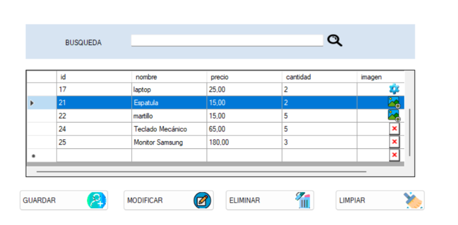
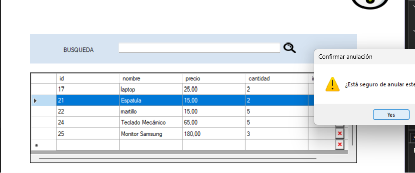
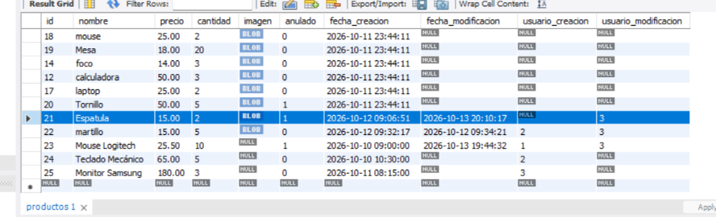
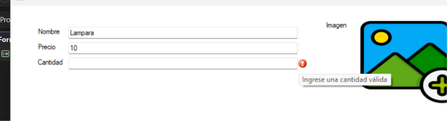
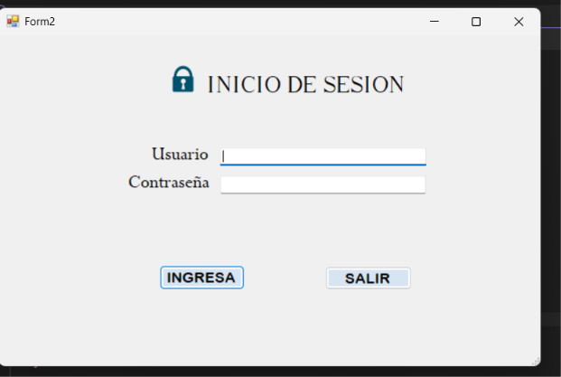
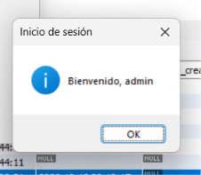
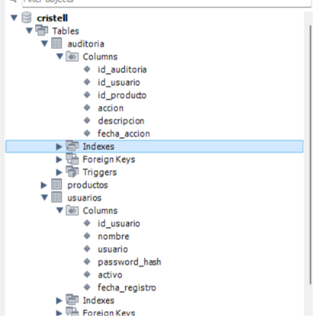
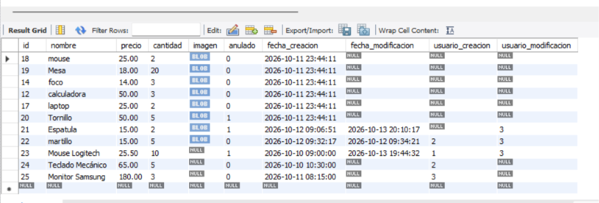

# Laboratorio 4 - HPA3

## Información del laboratorio

| Dato | Información |
|---|---|
| Curso | Herramientas de la Programación Aplicada III (.NET) |
| Laboratorio | #4 |
| Estudiante | Cristell Peters |
| Grupo | 1IL133 |
| Carrera | Ingeniería en Sistemas y Computación |
| Año | 2026 |
| Fecha | 14/09/2026 |
| Instructor | Ing. Irina Fong |

## Objetivos

🩷 Desarrollar una aplicación en C# Windows Forms para administrar productos y sus imágenes.

🩷 Implementar operaciones CRUD mediante una conexión con MySQL.

🩷 Convertir imágenes a arreglos de bytes para almacenarlas y recuperarlas desde la base de datos.

🩷 Aplicar interfaces, validaciones y manejo de errores para organizar el código.

🩷 Incorporar inicio de sesión y trazabilidad para registrar las operaciones realizadas por los usuarios.

## Descripción del laboratorio

En este laboratorio se desarrolló una aplicación en C# Windows Forms conectada a MySQL, que permite guardar, consultar, modificar y anular productos con su nombre, precio, cantidad e imagen.

La aplicación cuenta con un `DataGridView` para visualizar los registros, una barra de búsqueda, botones para administrar los productos y validaciones para evitar datos incorrectos.

Posteriormente se incorporaron mejoras como una interfaz de programación, métodos estáticos para las imágenes, eliminación lógica, inicio de sesión y auditoría de las operaciones realizadas.

## Diseño de la aplicación

Se diseñó un formulario en Windows Forms utilizando `TextBox`, `PictureBox`, `DataGridView` y botones para administrar los productos.

También se utilizó `ImageList` para agregar íconos a los botones y mejorar la presentación del formulario.


## Base de datos MySQL

Se utilizó una base de datos llamada `cristell`, donde se creó la tabla `productos` para almacenar la información ingresada desde la aplicación.

Inicialmente, esta tabla contenía los campos `id`, `nombre`, `precio`, `cantidad` e `imagen`.

El campo `imagen` utiliza el tipo `LONGBLOB`, que permite almacenar archivos de imagen convertidos a datos binarios (`byte[]`).


## Conexión entre C# y MySQL

La conexión se realiza mediante la clase `Conexion.cs`, utilizando `MySqlConnection` y el paquete `MySql.Data` instalado desde NuGet.

También se utilizan `MySqlCommand` para ejecutar las consultas SQL y `MySqlDataReader` para recuperar los productos almacenados.

## Funcionalidades principales

### 🩷 Guardar productos

El botón **GUARDAR** permite registrar productos en MySQL mediante el método `InsertSeguro()`.

Antes de guardar, se valida que los campos estén completos y que el precio y la cantidad contengan valores correctos. La imagen también se convierte a `byte[]` para almacenarse en la base de datos.

Después del registro, el `DataGridView` se actualiza y muestra el nuevo producto.

**Evidencia del registro:**


**Resultado:**


### 🩷 Consultar y buscar productos

Los productos se obtienen desde MySQL mediante el método `GetProductos()` y se organizan utilizando `List<Producto>`.

Los registros se muestran en el `DataGridView`, incluyendo sus imágenes. También se incorporó una barra de búsqueda para filtrar productos por ID, nombre, precio o cantidad.

### 🩷 Manejo de imágenes

Para almacenar imágenes en MySQL se utiliza `MemoryStream`, que permite convertirlas a un arreglo de bytes (`byte[]`).

Cuando la imagen se recupera desde la base de datos, se convierte nuevamente a `Bitmap` para mostrarla en el formulario.

### 🩷 Selección de imágenes

Se implementó `OpenFileDialog` para seleccionar imágenes desde la computadora.

El archivo seleccionado se muestra en el `PictureBox` y puede guardarse junto con la información del producto.

Se permiten formatos como `.jpg`, `.jpeg`, `.png` y `.bmp`.

---

## Actualización del 21/09/2026 - Funciones CRUD

En esta actualización se completaron las funciones para seleccionar, modificar, eliminar y limpiar registros desde el formulario.

### 🩷 Selección de productos

Mediante el evento `CellClick` del `DataGridView`, se obtiene la información del producto seleccionado y se muestra nuevamente en los campos del formulario.

También se conserva su ID para identificar el registro que se desea modificar o anular.

### 🩷 Botón Modificar

El botón **MODIFICAR** permite cambiar la información de un producto existente.

Después de seleccionar el registro, se pueden editar el nombre, precio, cantidad o imagen. El método `UpdateSeguro()` actualiza los datos en MySQL y posteriormente se recarga el `DataGridView`.

**Evidencia de modificación:**


**Resultado:**


### 🩷 Botón Eliminar

Se implementó el botón **ELIMINAR**, que solicita una confirmación mediante `MessageBox` antes de realizar la operación.

La eliminación se realiza mediante el método `DeleteSeguro()`. Posteriormente, esta funcionalidad fue actualizada para utilizar eliminación lógica, conservando el producto en la base de datos.

**Evidencia de eliminación:**


**Resultado:**


### 🩷 Botón Limpiar

El botón **LIMPIAR** permite vaciar los campos del formulario, restaurar la imagen predeterminada del `PictureBox` y reiniciar el producto seleccionado.

Esto facilita ingresar un nuevo producto sin conservar información del registro anterior.

### 🩷 Mejoras en las imágenes

Se mejoró la recuperación de imágenes desde MySQL para mostrarlas nuevamente al seleccionar un producto.

También se utilizó `File.ReadAllBytes` para leer archivos seleccionados y se configuró el `DataGridView` con el modo `Zoom`, permitiendo visualizar las imágenes completas dentro de sus celdas.

---

## Actualización del 05/10/2026 - Implementación de interfaz

Se incorporó la interfaz `IProductoRepository` para definir las operaciones necesarias para administrar los productos.

### 🩷 Creación de IProductoRepository

Se creó el archivo `IProductoRepository.cs` desde Visual Studio, utilizando la opción **Agregar → Nuevo elemento → Interfaz**.

La interfaz establece los métodos que debe implementar la clase encargada de realizar las operaciones con MySQL.

```csharp
using System.Collections.Generic;

namespace ProyectoProductos
{
    public interface IProductoRepository
    {
        List<Producto> GetProductos(string filtro);
        bool InsertSeguro(string tbName, Dictionary<string, object> data);
        bool UpdateSeguro(string tbName, Dictionary<string, object> data, int id);
        bool DeleteSeguro(string tbName, int id);
    }
}
```

**Evidencia de la interfaz:**


### 🩷 Implementación en Conexion.cs

Se modificó la clase `Conexion` para implementar la interfaz.

**Antes:**

```csharp
public class Conexion
```

**Ahora:**

```csharp
public class Conexion : IProductoRepository
```

Los métodos `GetProductos()`, `InsertSeguro()`, `UpdateSeguro()` y `DeleteSeguro()` se adaptaron para trabajar mediante una instancia de la clase.

### 🩷 Uso de la interfaz en Form1.cs

Dentro del formulario se declaró una variable de tipo `IProductoRepository`.

```csharp
private IProductoRepository conexionRepo;
```

Posteriormente se utiliza una instancia de `Conexion` para ejecutar las operaciones.

Por ejemplo:

```csharp
conexionRepo.InsertSeguro("productos", myProducto);
conexionRepo.UpdateSeguro("productos", myProducto, idSeleccionado);
conexionRepo.DeleteSeguro("productos", idSeleccionado);
```

### 🩷 Diferencias principales

| Antes | Ahora |
|---|---|
| Form1 utilizaba directamente Conexion | Form1 trabaja mediante IProductoRepository |
| Se utilizaban métodos estáticos | Se utilizan métodos de instancia |
| Las operaciones dependían de Conexion | Las operaciones siguen el contrato de la interfaz |
| Mayor dependencia del código | Mejor organización y mantenimiento |

Con este cambio se separó la parte visual de las operaciones de acceso a datos, manteniendo el funcionamiento del CRUD.

---

## Herramientas utilizadas

| Herramienta | Uso |
|---|---|
| C# | Lenguaje de programación |
| Windows Forms | Diseño de interfaces gráficas |
| .NET Framework 4.7.2 | Plataforma de desarrollo |
| Visual Studio | Desarrollo del proyecto |
| MySQL | Almacenamiento de información |
| MySQL Workbench | Administración de la base de datos |
| MySql.Data / NuGet | Conexión entre C# y MySQL |
| DataGridView | Visualización de productos |
| PictureBox | Visualización de imágenes |
| ImageList | Íconos de los botones |
| OpenFileDialog | Selección de imágenes |
| MemoryStream / Bitmap | Conversión de imágenes |
| ErrorProvider | Validación de los campos |

## Mejoras pendientes

Como posible mejora del proyecto se plantea normalizar los nombres de los productos antes de almacenarlos en MySQL.

Esto permitiría mantener un formato uniforme de mayúsculas, minúsculas, espacios y caracteres especiales, independientemente de cómo el usuario introduzca la información.

También se contempla reforzar la seguridad de las credenciales utilizadas durante el inicio de sesión.

---

# Última modificación del proyecto - 10/10/2026

En esta modificación se incorporaron nuevas funciones para mejorar el manejo de errores, la seguridad de las operaciones y el control de los registros almacenados en MySQL.

Las principales mejoras fueron la eliminación lógica, los métodos estáticos para imágenes, el uso de `ErrorProvider`, el inicio de sesión y la trazabilidad de las operaciones realizadas por los usuarios.

## 1. Mejoras en el manejo de productos

### 🩷 Eliminación lógica

Se modificó el método `DeleteSeguro()` para evitar que los productos se eliminen permanentemente de la base de datos.

Para esto se agregó el campo `anulado` en la tabla `productos`, utilizando los valores:

- `0`: producto activo.
- `1`: producto anulado.

Ahora, al presionar **ELIMINAR**, se utiliza una consulta `UPDATE` para cambiar el estado del producto.

```sql
UPDATE productos
SET anulado = 1
WHERE id = @id AND anulado = 0;
```

Los productos anulados dejan de mostrarse en el `DataGridView`, pero permanecen almacenados en MySQL.

**Evidencia de eliminación lógica:**





**Resultado en MySQL:**



### 🩷 Métodos estáticos para imágenes

Se actualizó la clase `Imagenes.cs` para reunir los métodos de conversión de imágenes.

Se implementaron dos métodos estáticos:

```csharp
public static byte[] ImageToByteArray(Image image)
public static Bitmap ByteArrayToBitmap(byte[] bytes)
```

El primero convierte imágenes a `byte[]` para guardarlas en MySQL, mientras que el segundo transforma los bytes nuevamente a `Bitmap` para visualizarlos.

Estos métodos permiten reutilizar las conversiones desde `Form1.cs` y evitar repetir código.


### 🩷 Manejo de errores con ErrorProvider

Se agregó el componente `ErrorProvider` al formulario para mostrar errores cuando los datos ingresados no son válidos.

Se modificó el método `datosCorrectos()` para verificar que:

- El nombre no esté vacío.
- El precio sea numérico y no sea negativo.
- La cantidad sea un número entero y no sea negativa.

Cuando se detecta un error, se muestra un ícono junto al campo correspondiente, indicando qué debe corregirse.

También se configuró el botón **LIMPIAR** para eliminar los mensajes de error.

**Evidencia de las validaciones:**



## 2. Inicio de sesión y trazabilidad

### 🩷 Formulario de inicio de sesión

Se creó un nuevo formulario llamado `Form2`, que permite ingresar al sistema mediante un usuario y una contraseña.

El formulario cuenta con los controles `txtUsuario`, `txtContra` y los botones **INGRESAR** y **SALIR**.

Al ingresar los datos, se utiliza el método `ValidarUsuario()` de la clase `Conexion` para comprobar que las credenciales correspondan a un usuario activo de MySQL.

Si son correctas, se abre `Form1` y se conserva el ID del usuario autenticado.

**Diseño del inicio de sesión:**



**Acceso al sistema:**



### 🩷 Actualización de la base de datos

Se modificó la base de datos `cristell` para almacenar la información relacionada con los usuarios y las operaciones realizadas.

La tabla `productos` incorporó los siguientes campos:

| Campo | Función |
|---|---|
| anulado | Indica si el producto está activo o anulado |
| fecha_creacion | Fecha y hora de registro |
| fecha_modificacion | Fecha y hora del último cambio |
| usuario_creacion | Usuario que registró el producto |
| usuario_modificacion | Último usuario que modificó o anuló el producto |

También se crearon dos tablas nuevas:

**Tabla usuarios:** almacena los usuarios autorizados para iniciar sesión, incluyendo su ID, nombre, usuario, contraseña de prueba y estado.

**Tabla auditoria:** conserva el historial de operaciones realizadas sobre los productos, incluyendo el usuario, la acción, el producto afectado y la fecha.

**Evidencia de la base de datos:**



### 🩷 Registro de operaciones

Se modificaron los métodos `InsertSeguro()`, `UpdateSeguro()` y `DeleteSeguro()` para registrar el usuario que realiza cada operación.

El método `RegistrarAuditoria()` se encarga de guardar el historial en la tabla `auditoria`, utilizando las siguientes acciones:

| Acción | Descripción |
|---|---|
| INSERTAR | Registro de un nuevo producto |
| MODIFICAR | Actualización de un producto existente |
| ANULAR | Eliminación lógica de un producto |

También se incorporaron `NOW()` para registrar las fechas y transacciones de MySQL para asegurar que cada operación se guarde junto con su auditoría.

**Evidencia de la trazabilidad:**



### 🩷 Identificación del usuario en Form1

Se modificó `Program.cs` para abrir primero el formulario de inicio de sesión.

Después de validar las credenciales, se envía a `Form1` el ID y nombre del usuario autenticado.

```csharp
new Form1(login.UsuarioId, login.NombreUsuario)
```

En `Form1.cs`, la instancia de `Conexion` recibe el ID del usuario:

```csharp
conexionRepo = new Conexion
{
    UsuarioActualId = idUsuarioActual
};
```

De esta manera, las operaciones de guardar, modificar y anular quedan relacionadas con la cuenta que inició sesión.

### 🩷 Resultado de la trazabilidad

Con estas modificaciones, el sistema permite identificar quién registró un producto, quién lo modificó y quién realizó su anulación.

La tabla `productos` conserva los datos de creación y de la última modificación, mientras que `auditoria` almacena el historial de las operaciones.

Esto permite consultar desde MySQL las acciones realizadas por los diferentes usuarios sin perder la información de los productos anulados.


