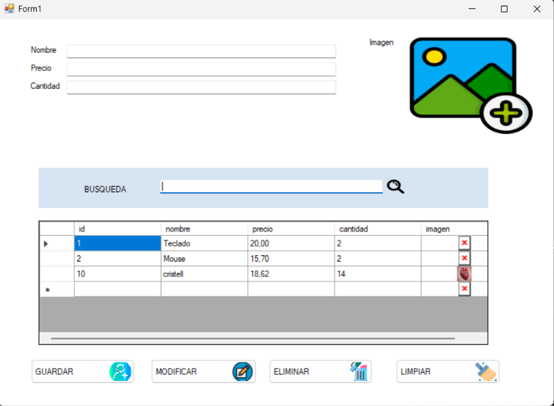
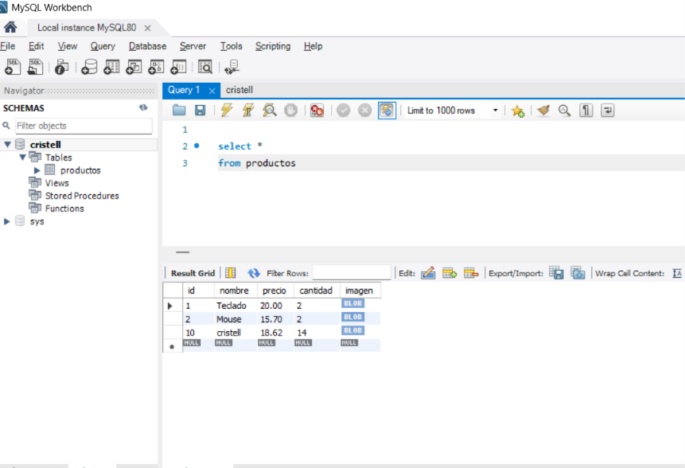
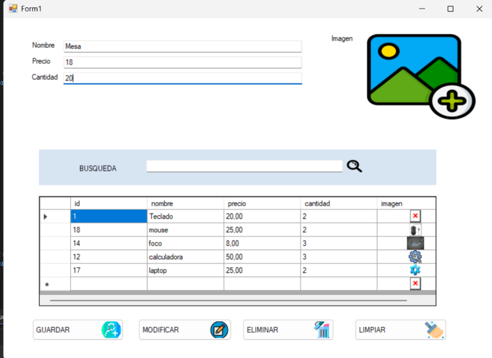
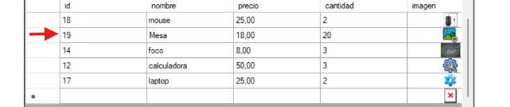
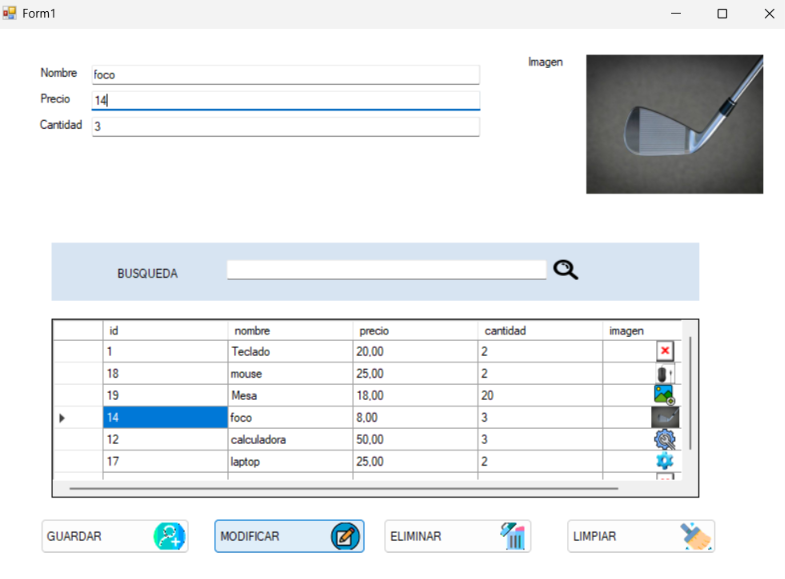
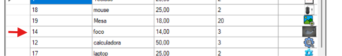
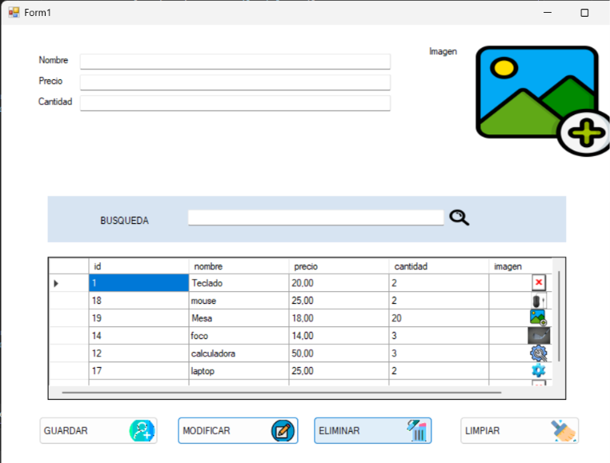
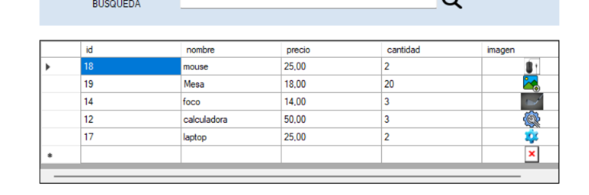
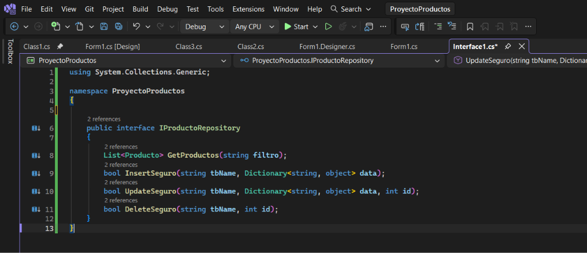

# Laboratorio 4 - HPA3

## Información del laboratorio

| Dato | Información |
|---|---|
| Curso | Herramientas de la Programación Aplicada III (.NET) |
| Laboratorio | #4 |
| Estudiante | Cristell Peters |
| Grupo | 1IL133 |
| Carrera | Ingeniería en Sistemas y Computación |
| Año | 2026 |
| Fecha | 14/09/2026 |
| Instructor | Ing. Irina Fong |

## Objetivos

🩷 Crear una aplicación en Windows Forms para administrar productos e imágenes.

🩷 Convertir imágenes a arreglos de bytes mediante `MemoryStream`.

🩷 Conectar C# con MySQL para registrar, consultar, modificar y eliminar productos.

🩷 Organizar las operaciones de acceso a datos mediante la interfaz `IProductoRepository`.

## Descripción

Se desarrolló una aplicación en C# Windows Forms conectada a MySQL para administrar productos con nombre, precio, cantidad e imagen.

La aplicación permite guardar productos, buscar registros, seleccionarlos desde un `DataGridView`, modificar su información, eliminarlos y limpiar el formulario.

## Diseño de la aplicación

El formulario incluye campos para los datos del producto, un `PictureBox` para visualizar su imagen y un `DataGridView` para mostrar los registros.

También se utilizó un `ImageList` para agregar imágenes a los botones.



## Base de datos y conexión

### Tabla de productos

La tabla `productos` almacena los siguientes campos:

| Campo | Descripción |
|---|---|
| `id` | Identificador del producto |
| `nombre` | Nombre del producto |
| `precio` | Precio del producto |
| `cantidad` | Cantidad disponible |
| `imagen` | Imagen almacenada como `LONGBLOB` |

Las imágenes se manejan en C# mediante arreglos de bytes (`byte[]`).



### Conexión con MySQL

La clase `Conexion` utiliza el paquete `MySql.Data`, instalado mediante NuGet.

| Componente | Función |
|---|---|
| `MySqlConnection` | Establecer la conexión con MySQL |
| `MySqlCommand` | Ejecutar instrucciones SQL |
| `MySqlDataReader` | Leer los resultados de las consultas |

Los registros se almacenan en una `List<Producto>` y se muestran en el `DataGridView`.

## Funcionalidades

### 🩷 Guardar

Valida que los campos estén completos y que el precio y la cantidad sean valores numéricos válidos. Luego registra los datos y la imagen del producto en MySQL.

Al finalizar, actualiza el `DataGridView` y muestra un mensaje de confirmación.

**Evidencia:**



**Resultado:**



### 🩷 Buscar y seleccionar

El campo de búsqueda permite filtrar los productos registrados.

Al seleccionar un producto mediante el evento `CellClick` del `DataGridView`, se cargan su nombre, precio, cantidad e imagen en el formulario. También se conserva su `id` para modificarlo o eliminarlo.

### 🩷 Modificar

Permite actualizar un producto seleccionado. Después de validar los datos, utiliza `UpdateSeguro` y actualiza el `DataGridView`.

**Evidencia:**



**Resultado:**



### 🩷 Eliminar

Solicita confirmación mediante `MessageBox` antes de ejecutar `DeleteSeguro` sobre el producto seleccionado.

Después de la operación, actualiza los registros del `DataGridView`.

**Evidencia:**



**Resultado:**



### 🩷 Limpiar

Vacía los campos de nombre, precio y cantidad, restaura la imagen predeterminada y reinicia la selección del producto y la ruta de la imagen.

## Manejo de imágenes

### Selección

Se utiliza `OpenFileDialog` para seleccionar imágenes en formatos `.jpg`, `.png` y `.bmp`. La imagen seleccionada se muestra en el `PictureBox` antes de guardar el producto.

### Conversión y visualización

| Elemento | Función |
|---|---|
| `MemoryStream` | Convertir la imagen a bytes y recuperar sus datos |
| `File.ReadAllBytes` | Leer los bytes de una imagen seleccionada desde un archivo |
| `Bitmap` | Reconstruir la imagen a partir de sus datos |
| `PictureBox` | Mostrar la imagen del producto |
| `DataGridView` con modo `Zoom` | Mostrar la imagen completa dentro de la celda |

## Interfaz de acceso a datos (Actualizacion realizada el 05/10/2026)

### 🩷 `IProductoRepository.cs`

La interfaz define las operaciones que debe implementar la clase encargada de acceder a los productos.

Para crearla en Visual Studio:

1. Clic derecho sobre `ProyectoProductos`.
2. Seleccionar **Agregar → Nuevo elemento → Interfaz**.
3. Asignar el nombre `IProductoRepository.cs`.

```csharp
using System.Collections.Generic;

namespace ProyectoProductos
{
    public interface IProductoRepository
    {
        List<Producto> GetProductos(string filtro);
        bool InsertSeguro(string tbName, Dictionary<string, object> data);
        bool UpdateSeguro(string tbName, Dictionary<string, object> data, int id);
        bool DeleteSeguro(string tbName, int id);
    }
}
```



### 🩷 Implementación en `Conexion.cs`

La clase `Conexion` implementa la interfaz:

```csharp
public class Conexion : IProductoRepository
```

Se retiró `static` de los métodos `GetProductos`, `InsertSeguro`, `UpdateSeguro` y `DeleteSeguro` para utilizarlos mediante una instancia.

### 🩷 Uso en `Form1.cs`

El formulario declara una variable de tipo `IProductoRepository` y la inicializa con una instancia de `Conexion`.

```csharp
private IProductoRepository conexionRepo;

public Form1()
{
    InitializeComponent();
    conexionRepo = new Conexion();
}
```

Las operaciones se ejecutan mediante `conexionRepo`:

```csharp
conexionRepo.GetProductos(...);
conexionRepo.InsertSeguro(...);
conexionRepo.UpdateSeguro(...);
conexionRepo.DeleteSeguro(...);
```

### Comparación del código

| Aspecto | Antes | Ahora |
|---|---|---|
| Acceso desde el formulario | Llamadas estáticas a `Conexion` | Llamadas mediante `conexionRepo` |
| Métodos del repositorio | Estáticos | De instancia |
| Contrato de operaciones | Sin interfaz | Definido en `IProductoRepository` |
| Reemplazo del repositorio | Requería cambiar las llamadas a `Conexion` | Permite utilizar otra clase que implemente la interfaz |

El formulario utiliza las operaciones definidas por `IProductoRepository`, y `Conexion` contiene su implementación para MySQL. El constructor todavía crea la instancia concreta mediante `new Conexion()`.

## Última modificación — 10/10/2026

Se agregaron dos cambios principales: la estructura de usuarios en MySQL y el inicio de sesión mediante programación en capas. También se incorporó el manejo de errores para controlar problemas durante el acceso a la aplicación.

### 🩷 Base de datos de usuarios

Se creó la tabla `usuarios` para almacenar las credenciales y la información de cada usuario.

| Campo | Descripción |
|---|---|
| `id` | Identificador numérico del usuario |
| `dsId` | Código del usuario |
| `dsUsuario` | Nombre utilizado para iniciar sesión |
| `dsPassword` | Contraseña almacenada como hash |
| `dsEstado` | Estado del usuario |
| `dsUsuarioCreacion` | Usuario que creó el registro |
| `dtFechaCreacion` | Fecha de creación |
| `dsUsuarioModificacion` | Usuario que modificó el registro |
| `dtFechaModificacion` | Fecha de modificación |

El campo `dsPassword` utiliza `VARBINARY(64)` para almacenar el resultado binario de SHA-512.

Al registrar un usuario, se utiliza `SHA2` para generar el hash de la contraseña y `UNHEX` para convertirlo a bytes.

```sql
INSERT INTO usuarios
    (dsId, dsUsuario, dsPassword, dsEstado, dsUsuarioCreacion)
VALUES
    ('001', 'admin', UNHEX(SHA2('123456', 512)), '1', 'Sistema');
```

**Evidencia:**

<!-- Agregar aquí la imagen de la estructura de la tabla usuarios. -->

#### Procedimiento de validación

Se agregó el procedimiento almacenado `sp_ValidarLoginHash`, que recibe el nombre de usuario y la contraseña.

El procedimiento busca un registro que coincida con las credenciales y que tenga el estado activo (`dsEstado = '1'`). Para comparar la contraseña ingresada, aplica la misma transformación utilizada al guardarla.

```sql
WHERE dsUsuario = _dsUsuario
  AND dsPassword = UNHEX(SHA2(_dsPassword, 512))
  AND dsEstado = '1';
```

**Evidencia:**

<!-- Agregar aquí la imagen del procedimiento almacenado. -->

### 🩷 Inicio de sesión por capas

Se incorporó un formulario de inicio de sesión con campos para el usuario y la contraseña, y un botón para ingresar.

La funcionalidad se organizó en cuatro capas:

| Capa | Elementos | Función |
|---|---|---|
| Entidades | `E_Usuario` | Representar los datos del usuario |
| Datos | `D_Conexion` y `D_Usuario` | Conectarse a MySQL y ejecutar la validación |
| Negocio | `N_Usuario` | Comunicar el formulario con la capa de Datos |
| Presentación | `frmLogin` y `frmPrincipal` | Mostrar las ventanas de la aplicación |

Se agregaron las referencias entre los proyectos y el paquete `MySql.Data` en la capa de Datos.

#### Validación de credenciales

Al presionar el botón de iniciar sesión, el formulario obtiene las credenciales y llama al método `Login` de `N_Usuario`.

```csharp
E_Usuario usuario = N_Usuario.Login(strUsuario, strPassword);
```

La capa de Negocio llama a `D_Usuario`, que ejecuta el procedimiento almacenado mediante `MySqlCommand` y envía las credenciales como parámetros.

Los resultados se leen con `MySqlDataReader`. Si existe una coincidencia, se devuelve un objeto `E_Usuario` con los datos encontrados.

**Evidencia:**

<!-- Agregar aquí la imagen del formulario de inicio de sesión. -->

#### Acceso a la aplicación

Cuando las credenciales son correctas, se muestra un mensaje de bienvenida y se abre `frmPrincipal`.

Si las credenciales no coinciden con un usuario activo, se muestra un mensaje de error y se mantiene el formulario de inicio de sesión.

También se configuró `Program.cs` para que la aplicación comience en `frmLogin`.

```csharp
Application.Run(new frmLogin());
```

**Resultado:**

<!-- Agregar aquí la imagen del acceso correcto y del formulario principal. -->

### 🩷 Manejo de errores

Se agregó el manejo de excepciones mediante `try-catch` en el acceso a datos para controlar errores de conexión o de ejecución del procedimiento almacenado.

Además, se verifica el resultado del método `Login` antes de utilizar los datos del usuario. Esto evita acceder a un objeto `null` cuando la validación no devuelve un registro.

| Situación | Comportamiento |
|---|---|
| Credenciales correctas y usuario activo | Permite abrir el formulario principal |
| Usuario o contraseña incorrectos | Muestra un mensaje de acceso fallido |
| Usuario inactivo | No permite iniciar sesión |
| Error de conexión o consulta | Se controla mediante el manejo de excepciones |

**Evidencia:**

<!-- Agregar aquí las imágenes de las pruebas de acceso fallido y manejo de errores. -->


## Herramientas utilizadas

| Herramienta | Uso |
|---|---|
| C# y .NET | Desarrollo de la aplicación |
| Windows Forms | Interfaz gráfica |
| Visual Studio | Entorno de desarrollo |
| MySQL y MySQL Workbench | Administración de la base de datos |
| NuGet / `MySql.Data` | Instalación del conector de MySQL |
| `DataGridView` | Visualización y selección de productos |
| `PictureBox` | Visualización de imágenes |
| `ImageList` | Imágenes de los botones |
| `OpenFileDialog` | Selección de archivos de imagen |
| `MemoryStream` | Conversión de imágenes |
